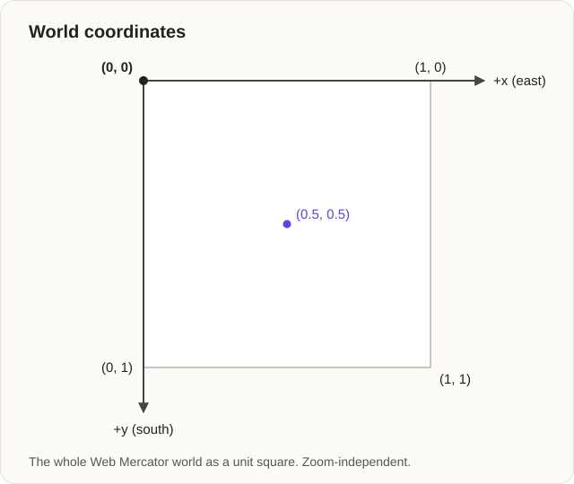
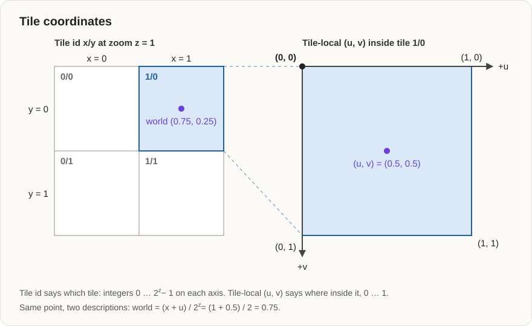
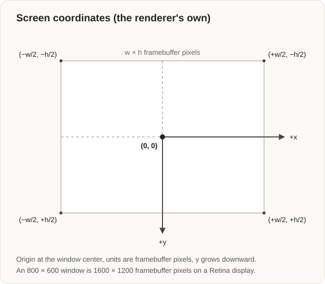
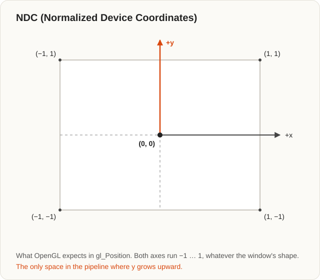

Hi, I'm Yul and I'm writing this post to learn raster maps in depth. I'm currently working on my side project [raster-map](https://github.com/kangyul/raster-map). I wanted to know how a map engine works and this is my starter project.

## Four coordinate systems

### World coordinates
The entire world map is a unit square. The origin is at the top-left and the y grows south.

### Tile coordinates
There are two things to think about in tile coordinates. The first one is z/x/y. At zoom z, the world square is cut into 2^z × 2^z tiles. x is the column and y is the row counted from the top-left, integers from 0 to 2^z - 1. For example, at z = 1 there are four tiles and tile 1/0 is the top-right one; its left edge sits at world x = 0.5, not 1.

The second is tile-local coordinates, (u, v): it's used for a specific point in a tile and the range is [0, 1]. The origin is at the top-left and y grows south (same as the world coordinates).

### Screen coordinates
Think of screen coordinates as your small window in your desktop. The width of screen coordinates is the size of the window's framebuffer width and the height is the size of the window's framebuffer height. The previous two coordinates' origin was in top-left. However, this one's origin is in the middle. This one's y also grows south. The range is from negative value of half of the width and the half of the width; height is same.

### NDC
NDC is the final destination of coordinate transformations. The origin is at the center, both axes run from -1 to 1, and unlike the previous three, y grows north. "Normalized" means the window's size has been divided out: the window's right edge is always x = 1, whether the window is 800 or 1600 pixels wide. So the GPU never needs to know the window size. Our code divides it out in our own transform, the one that turns a tile id into an NDC rectangle, and `glViewport` stretches -1 ... 1 back to real pixels.

## From a tile to the screen

### Step 1) tile → world

Let's say we have a tile id: (z/x/y) = (1/1/0) and the tile-local coordinates (u, v) = (0.5, 0.5). We want to express this point in world coordinates. When transforming a coordinate to another, we need to consider three things: origin, x and y axis direction, and range.
- **Origin**: A tile's (0, 0) is not the world's (0, 0). It sits at the tile's top-left corner, which is world (x / 2^z, y / 2^z). For tile (1/1/0) that's world's (0.5, 0).
- **x and y axis direction**: Both coordinate systems' x grows east and y grows south.
	- **Range**: Both run from 0 to 1, but a tile covers only 1 / 2^z of the world. So the 0.5 in tile-local coordinates is half a tile, which is 0.25 in world units at z = 1.

$$
\mathrm{world}_x = \frac{x + u}{2^z}
$$

Our example point, tile 1/1/0 with $(u, v) = (0.5, 0.5)$, lands at world $x = (1 + 0.5) / 2 = 0.75$. y works the same way: $(0 + 0.5) / 2 = 0.25$.

### Step 2) world → screen
* **Origin**: The origin is now at the middle of the screen coordinates.
* **x and y axis direction**: Same as the world coordinates; x grows east and y grows south.
* **Range**: [-w/2, w/2], [-h/2, h/2]; now the range is the width and the height of a window.

Here $s$ is the scale that turns world units into pixels: $s = 256 \cdot 2^{zoom}$ pixels per world unit. One tile is then 256 pixels wide whenever the camera's zoom matches the tile's z.

$$
\mathrm{screen}_x = (\mathrm{world}_x - \mathrm{center}_x) \cdot s
$$

Say the camera sits at $\mathrm{center} = (0.5, 0.5)$ with zoom 1, so $s = 512$, in an 800 x 600 window on a Retina display (1600 x 1200 framebuffer pixels). Our point lands at screen $(128, -128)$: 128 pixels right of the center, and 128 pixels above it.

### Step 3)  screen → NDC
* **Origin**: The origin is at the middle of NDC.
* **x and y axis direction**: X grows east as usual but now the y flips; y grows north.
* **Range**: both [-1, 1]

$$
\mathrm{ndc}_x = \mathrm{screen}_x \cdot \frac{2}{w}
$$
$$
\mathrm{ndc}_y = -\,\mathrm{screen}_y \cdot \frac{2}{h}
$$

Our point ends up at $\mathrm{ndc}_x = 128 \cdot 2 / 1600 = 0.16$ and $\mathrm{ndc}_y = -(-128) \cdot 2 / 1200 \approx 0.21$. Both are positive, so the point sits right of the center and above it. Notice the sign of y: it was negative in screen coordinates and is positive here. That is the flip.

Next time I'll write how these three steps fold into the four floats the shader actually receives.
